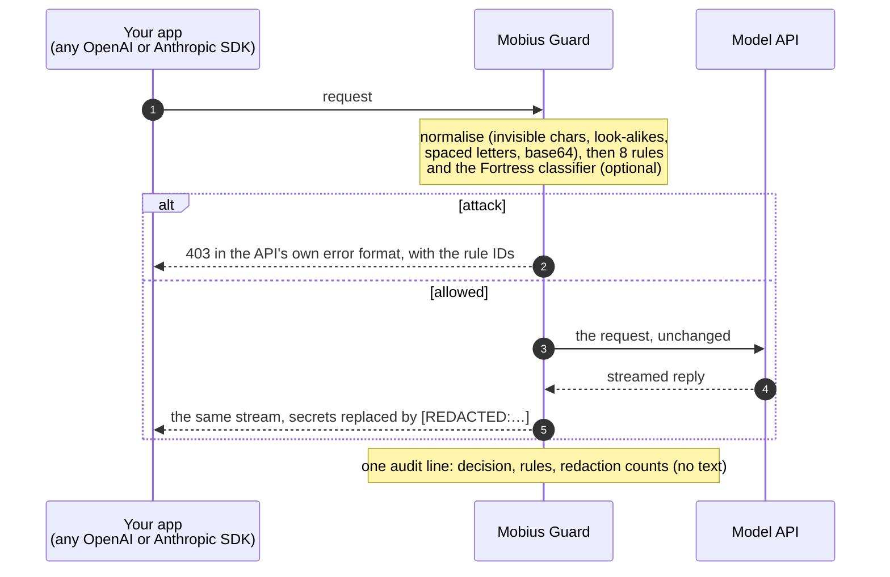
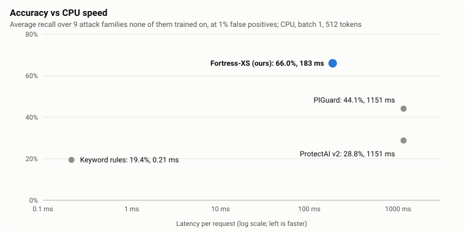
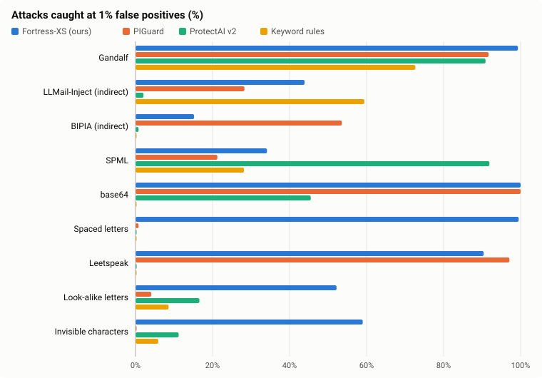
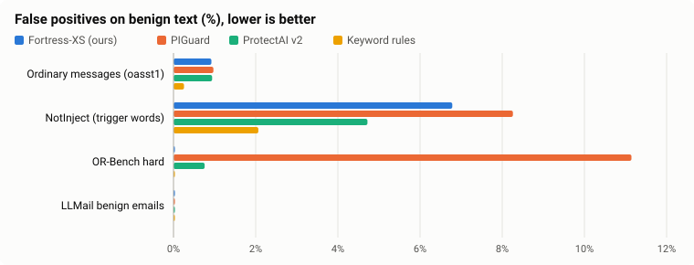
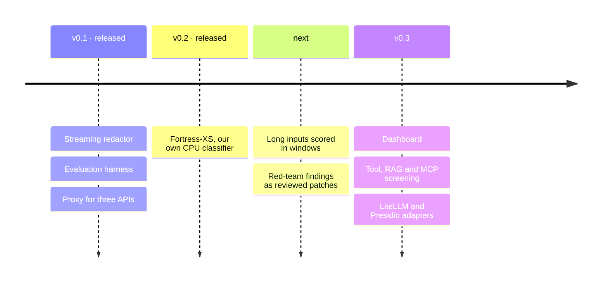

<p align="center">
  <picture>
    <source media="(prefers-color-scheme: dark)" srcset=".github/assets/lockup-dark.png">
    
  </picture>
</p>

<h3 align="center">An open-source firewall for LLM apps.</h3>

<p align="center">
  Rewrites secrets in a streamed reply without stopping the stream,<br>
  and measures every claim on data the detector never saw.
</p>

<p align="center">
  <a href="#licence"></a>
  <a href="https://pypi.org/project/mobiusguard/"></a>
  <a href="https://github.com/gantrly/mobius-guard/actions/workflows/ci.yml"></a>
  <a href="https://www.bestpractices.dev/projects/16287"></a>
  <a href="https://scorecard.dev/viewer/?uri=github.com/gantrly/mobius-guard"></a>
  
  
  
  <a href="https://github.com/gantrly"></a>
</p>

<p align="center">
  <a href="#how-it-works">How it works</a> ·
  <a href="#results">Results</a> ·
  <a href="#quickstart">Quickstart</a> ·
  <a href="#documentation">Docs</a> ·
  <a href="#roadmap">Roadmap</a> ·
  <a href="CONTRIBUTING.md">Contributing</a>
</p>

<p align="center">
  <picture>
    <source media="(prefers-color-scheme: dark)" srcset=".github/assets/hero-dark.svg">
    
  </picture>
</p>

<p align="center"><sub>The real redactor, replayed chunk by chunk by <a href="scripts/brand/hero.py"><code>hero.py</code></a>.</sub></p>

<p align="center">
  <picture>
    <source media="(prefers-color-scheme: dark)" srcset=".github/assets/stats-dark.svg">
    
  </picture>
</p>

## Why Mobius Guard

| | |
|---|---|
| **Redacts mid-stream** | Secrets and personal data are replaced as the reply streams, even when split across chunks. The stream never stops. |
| **Handles what models really write** | Tokens with characters added or dropped, keys in backticks, URLs without a host: still caught. |
| **Honest numbers** | Recall at a fixed false-positive rate, on pinned datasets the models were not trained on, with the weak spots published. |
| **Its own classifier** | [Fortress-XS](https://huggingface.co/gantrly/fortress-xs): prompt injection and harmful requests, 81 MB, 183 ms on a CPU at 512 tokens, Apache-2.0. [Try it in your browser](https://huggingface.co/spaces/gantrly/fortress-xs). |
| **Drop-in proxy** | OpenAI Chat Completions, OpenAI Responses and Anthropic Messages, streamed or not. Change one base URL. |

## How it works



User messages and tool results are checked; your own system prompt is not. Nothing is
logged in plain text unless you ask. Details: [architecture](docs/architecture.md),
[threat model](docs/threat-model.md).

## Results

### Fortress-XS, our classifier

<picture>
  <source media="(prefers-color-scheme: dark)" srcset="docs/assets/fortress-speed-dark.svg">
  
</picture>

<picture>
  <source media="(prefers-color-scheme: dark)" srcset="docs/assets/fortress-recall-dark.svg">
  
</picture>

| Recall at 1% false positives (%) | **Fortress-XS** | PIGuard | ProtectAI v2 | Keyword rules |
|---|---:|---:|---:|---:|
| Gandalf (direct injection) | **99.3** | 91.7 | 90.9 | 72.7 |
| LLMail-Inject (indirect, adaptive) | 43.9 | 28.3 | 2.1 | **59.4** |
| BIPIA (indirect) | 15.2 | **53.6** | 0.8 | 0.0 |
| SPML (system-prompt chatbots) | 34.1 | 21.3 | **91.9** | 28.2 |
| Obfuscated: base64 / spaced / leetspeak | **100** / **99.5** / 90.4 | **100** / 0.8 / **97.1** | 45.5 / 0.0 / 0.3 | 0.0 / 0.0 / 0.2 |
| Obfuscated: look-alike / invisible characters | **52.2** / **59.0** | 4.1 / 0.2 | 16.6 / 11.2 | 8.6 / 5.9 |
| **Average of these 9** | **66.0** | 44.1 | 28.8 | 19.4 |
| False positives: NotInject / OR-Bench hard | 6.8 / 0.0 | 8.3 / 11.1 | 4.7 / 0.8 | 2.1 / 0.0 |
| CPU latency at 512 tokens, size | **183 ms, 81 MB** | 1,151 ms | 1,151 ms | 0.2 ms |

- **Held out:** every number is on test sets no compared detector trained on, scored once.
  Thresholds are set so that 1% of ordinary user messages are flagged.
- **Where each detector wins:** Fortress-XS leads on obfuscation and direct injection. On
  the four non-obfuscated families it is level with PIGuard (48.1 vs 48.7). PIGuard wins
  BIPIA and ProtectAI v2 wins SPML.

<picture>
  <source media="(prefers-color-scheme: dark)" srcset="docs/assets/fortress-false-positives-dark.svg">
  
</picture>

| False positives at the same threshold (%) | **Fortress-XS** | PIGuard | ProtectAI v2 | Keyword rules |
|---|---:|---:|---:|---:|
| Ordinary messages (oasst1 test half, 16,061) | 0.9 | 1.0 | 0.9 | 0.3 |
| NotInject: harmless text with attack trigger words (339) | 6.8 | 8.3 | **4.7** | 2.1 |
| OR-Bench hard: harmless prompts that sound harmful (1,319) | **0.0** | 11.1 | 0.8 | 0.0 |
| LLMail-Inject benign emails (160) | 0.0 | 0.0 | 0.0 | 0.0 |
| English ordinary messages (7,668) | 1.3 | 0.6 | **0.1** | 0.5 |

**The second output: harmful requests.** Same threshold rule. It isn't compared with other
detectors: none of the three above has this output.

| Fortress-XS harmful output, at 1% false positives (%) | |
|---|---:|
| Caught: OR-Bench toxic (655) | 90.4 |
| Caught: XSTest unsafe (200) | 84.0 |
| Flagged by mistake: XSTest safe prompts (250) | 8.0 |
| Flagged by mistake: OR-Bench hard, harmless but sounding harmful (1,319) | **48.2** |
| The attack output firing on these harmful requests | 0.0 |

The harmful output over-blocks prompts that only sound harmful, so the proxy only logs it
unless you set `harmful = "block"`.

- **More:** the full scorecard, training data and limits are in the
  [model card](https://huggingface.co/gantrly/fortress-xs) and the
  [results note](docs/results/2026-11-07-classifier-v0.2-retrain.md). You can try it in the
  [demo](https://huggingface.co/spaces/gantrly/fortress-xs): the model runs in your browser.

### The proxy and the redactor

<picture>
  <source media="(prefers-color-scheme: dark)" srcset=".github/assets/obfuscation-dark.svg">
  
</picture>

- **Redaction:** 0 of 15,000 secrets leaked, exact or garbled, streamed in random chunks
  through real messages ([2026-11-02](docs/results/2026-11-02-redactor.md)).
- **Request rules:** no false blocks on 23,221 benign texts, under a millisecond each
  ([2026-10-29](docs/results/2026-10-29-proxy.md)).
- **Live:** 20 of 20 checks with the official OpenAI and Anthropic SDKs against a real model
  ([2026-10-30](docs/results/2026-10-30-live-check.md)).
- **Still hard for every detector:** indirect and adaptive attacks (LLMail-Inject, BIPIA).
  Fortress-XS raised LLMail-Inject from 12% to 44%; BIPIA-style injections are its
  weakest family.

## Quickstart

```sh
pip install "mobiusguard[onnx]"   # Python 3.11 or newer; [onnx] adds the Fortress classifier
mobiusguard serve --port 8787 --config mobiusguard.toml
```

```toml
# mobiusguard.toml
[policy]
classifier = "fortress-xs"   # blocks attacks at the model's own threshold
harmful = "log"              # harmful requests: log (default), block or off
```

```python
from openai import OpenAI

client = OpenAI(base_url="http://127.0.0.1:8787/v1")  # your usual key; that's all
```

<details>
<summary>The redactor on its own, or the proxy in a container</summary>

```python
from mobiusguard_redact import StreamRedactor

r = StreamRedactor()
for chunk in model_stream:
    send(r.feed(chunk))  # what is safe to show now
send(r.flush())
```

```sh
docker build -t mobiusguard . && docker run -p 127.0.0.1:8787:8787 mobiusguard
```

</details>

| Package | What | Depends on |
|---|---|---|
| `mobiusguard-redact` | Streaming redaction, for any gateway or app | `regex` only |
| `mobiusguard` | The proxy | the redactor, Starlette, httpx; `[onnx]` adds onnxruntime and tokenizers for Fortress |
| `mobiusguard-eval` | The evaluation harness | both, plus NumPy and PyArrow |

## Documentation

[Quickstart](docs/quickstart.md) · [Configuration](docs/configuration.md) ·
[Rules](docs/rules.md) · [Redaction](docs/redaction.md) · [Audit log](docs/audit-log.md) ·
[Deploy](docs/deploy.md) · [Results](docs/results/) · [Decisions](docs/decisions/) ·
[Development](docs/development.md)

## Roadmap



More in [ROADMAP.md](docs/ROADMAP.md) and the [changelog](CHANGELOG.md).

## Part of Gantrly

Built by the people behind [Gantrly](https://github.com/gantrly), whose AI agent will
run behind it. Mobius Guard has no dependency on Gantrly and works with any LLM app.

## Contributing

Issues and pull requests are welcome: start with [CONTRIBUTING.md](CONTRIBUTING.md).
Questions and ideas: [Discussions](https://github.com/gantrly/mobius-guard/discussions).
Found a way past the guard? Report it privately ([SECURITY.md](SECURITY.md)).

## Licence

[Apache-2.0](LICENSE), with contributions signed off under the
[DCO](https://developercertificate.org/) (no CLA). The gitleaks rules are MIT
([NOTICE](NOTICE)). Datasets are not included; their licences are in
[datasets.md](docs/datasets.md).
