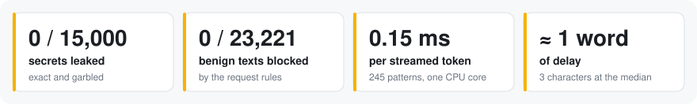
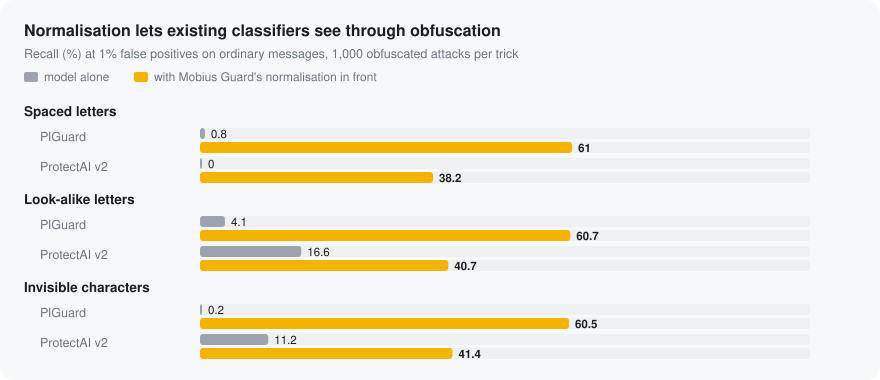
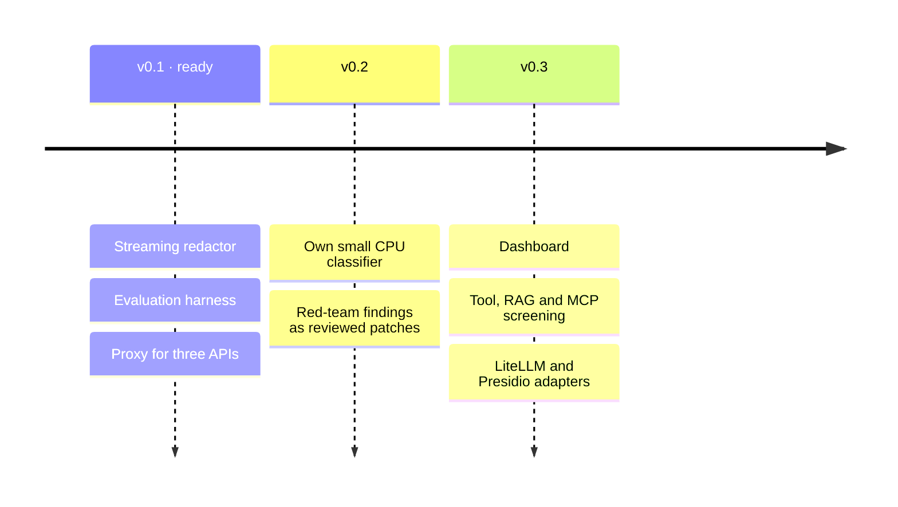

<p align="center">
  <picture>
    <source media="(prefers-color-scheme: dark)" srcset=".github/assets/lockup-dark.png">
    
  </picture>
</p>

<h3 align="center">An open-source firewall for LLM apps.</h3>

<p align="center">
  Rewrites secrets in a streamed reply without stopping the stream,<br>
  and measures every claim on data the detector never saw.
</p>

<p align="center">
  <a href="#licence"></a>
  
  <a href="https://github.com/gantrly/mobius-guard/actions/workflows/ci.yml"></a>
  <a href="https://scorecard.dev/viewer/?uri=github.com/gantrly/mobius-guard"></a>
  
  
  
  <a href="https://github.com/gantrly/gantrly"></a>
</p>

<p align="center">
  <a href="#how-it-works">How it works</a> ·
  <a href="#results">Results</a> ·
  <a href="#quickstart">Quickstart</a> ·
  <a href="#documentation">Docs</a> ·
  <a href="#roadmap">Roadmap</a> ·
  <a href="CONTRIBUTING.md">Contributing</a>
</p>

<p align="center">
  <picture>
    <source media="(prefers-color-scheme: dark)" srcset=".github/assets/hero-dark.svg">
    
  </picture>
</p>

<p align="center"><sub>The real redactor, replayed chunk by chunk by <a href="scripts/brand/hero.py"><code>hero.py</code></a>.</sub></p>

<p align="center">
  <picture>
    <source media="(prefers-color-scheme: dark)" srcset=".github/assets/stats-dark.svg">
    
  </picture>
</p>

## Why Mobius Guard

| | |
|---|---|
| **Redacts mid-stream** | Secrets and personal data are replaced as the reply streams, even when split across chunks. The stream never stops. |
| **Handles what models really write** | Tokens with characters added or dropped, keys in backticks, URLs without a host: still caught. |
| **Honest numbers** | Recall at a fixed false-positive rate, on pinned datasets the models were not trained on, with the weak spots published. |
| **Drop-in proxy** | OpenAI Chat Completions, OpenAI Responses and Anthropic Messages, streamed or not. Change one base URL. |

## How it works


User messages and tool results are checked; your own system prompt is not. Nothing is
logged in plain text unless you ask. Details: [architecture](docs/architecture.md),
[threat model](docs/threat-model.md).

## Results

<picture>
  <source media="(prefers-color-scheme: dark)" srcset=".github/assets/obfuscation-dark.svg">
  
</picture>

- **Redaction:** 0 of 15,000 secrets leaked, exact or garbled, streamed in random chunks
  through real messages ([2026-11-02](docs/results/2026-11-02-redactor.md)).
- **Request rules:** no false blocks on 23,221 benign texts, under a millisecond each
  ([2026-10-29](docs/results/2026-10-29-proxy.md)).
- **Live:** 20 of 20 checks with the official OpenAI and Anthropic SDKs against a real model
  ([2026-10-30](docs/results/2026-10-30-live-check.md)).
- **Still hard for every detector:** indirect and adaptive attacks (LLMail-Inject, BIPIA).
  That is what v0.2's own classifier is for.

## Quickstart

```sh
pip install mobiusguard        # not on PyPI yet: until v0.1, `uv run mobiusguard` in a checkout
mobiusguard serve --port 8787
```

```python
from openai import OpenAI

client = OpenAI(base_url="http://127.0.0.1:8787/v1")  # your usual key; that's all
```

<details>
<summary>The redactor on its own, or the proxy in a container</summary>

```python
from mobiusguard_redact import StreamRedactor

r = StreamRedactor()
for chunk in model_stream:
    send(r.feed(chunk))  # what is safe to show now
send(r.flush())
```

```sh
docker build -t mobiusguard . && docker run -p 127.0.0.1:8787:8787 mobiusguard
```

</details>

| Package | What | Depends on |
|---|---|---|
| `mobiusguard-redact` | Streaming redaction, for any gateway or app | `regex` only |
| `mobiusguard` | The proxy | the redactor, Starlette, httpx |
| `mobiusguard-eval` | The evaluation harness | both, plus NumPy and PyArrow |

## Documentation

[Quickstart](docs/quickstart.md) · [Configuration](docs/configuration.md) ·
[Rules](docs/rules.md) · [Redaction](docs/redaction.md) · [Audit log](docs/audit-log.md) ·
[Deploy](docs/deploy.md) · [Results](docs/results/) · [Decisions](docs/decisions/) ·
[Development](docs/development.md)

## Roadmap



More in [ROADMAP.md](docs/ROADMAP.md) and the [changelog](CHANGELOG.md).

## Part of Gantrly

Built by the people behind [Gantrly](https://github.com/gantrly/gantrly), whose AI agent will
run behind it. Mobius Guard has no dependency on Gantrly and works with any LLM app.

## Contributing

Issues and pull requests are welcome: start with [CONTRIBUTING.md](CONTRIBUTING.md).
Questions and ideas: [Discussions](https://github.com/gantrly/mobius-guard/discussions).
Found a way past the guard? Report it privately ([SECURITY.md](SECURITY.md)).

## Licence

[Apache-2.0](LICENSE), with contributions signed off under the
[DCO](https://developercertificate.org/) (no CLA). The gitleaks rules are MIT
([NOTICE](NOTICE)). Datasets are not included; their licences are in
[datasets.md](docs/datasets.md).
