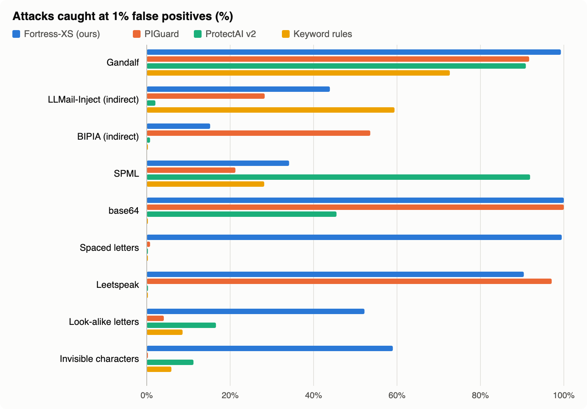

<p align="center">
  
</p>

# mobiusguard-eval

**An honest evaluation harness for LLM guardrails.** It scores prompt-injection detectors
the way a deployment would use them: recall at a fixed false-positive rate, with the
threshold set on ordinary traffic, on data the detector was not trained on. It also tests
the streaming redactor. The harness behind
[Mobius Guard](https://github.com/gantrly/mobius-guard)'s published numbers.

```sh
pip install "mobiusguard-eval[sklearn,hf]"

mobiusguard-eval sources                     # the provenance ledger
mobiusguard-eval build --out runs/suite      # fetch pinned data, build the suite
mobiusguard-eval score --suite runs/suite --detector piguard --device cuda --out runs/piguard
mobiusguard-eval report --suite runs/suite --runs runs/piguard --out runs/report
```

Or everything in order: `mobiusguard-eval pipeline --out runs --device cuda`. Every step
saves its work as it goes and skips what is already done for the same inputs, so a crash
or a fix never means starting over (`--force` redoes a step).

## Train and export a classifier

The same harness built [Fortress-XS](https://huggingface.co/gantrly/fortress-xs), Mobius
Guard's own classifier, and measured it against the published ones:

```sh
mobiusguard-eval train-data --suite runs/suite --out runs/train   # licensed sources, suite overlap removed
mobiusguard-eval judge --data runs/train --out runs/judge         # optional: two LLM judges label it
mobiusguard-eval apply-judges --data runs/train --judged runs/judge --out runs/clean
mobiusguard-eval train --data runs/clean --base deberta-v3-xsmall --out runs/model
mobiusguard-eval export --model runs/model/best --out runs/onnx --val runs/clean/val.jsonl
mobiusguard-eval score --suite runs/suite --detector local:runs/model/best --out runs/mine
```

Training needs a GPU (`[train]`); the judges need `[judge]` and are paid model calls.
Export writes ONNX and INT8 and refuses an INT8 model that disagrees with PyTorch. Every
step resumes after a crash. Each training source is
in the ledger with its licence, and any source of the evaluation suite is refused.

<p align="center">
  
</p>

## What makes the numbers honest

- **A provenance ledger.** Every dataset is pinned to a commit or a SHA-256, with its
  licence and the published detectors known to have trained on it. Their numbers on those
  sets are marked †.
- **Thresholds from ordinary traffic.** Half of a real-user message set (oasst1) sets each
  detector's threshold for 0.1%, 1% or 5% false positives. Every attack set and every
  hard-benign set is reported out of sample.
- **Families, not rows.** Attacks are reported per source, plus five deterministic
  obfuscations (spaced letters, look-alike letters, zero-width characters, leetspeak,
  base64). Near duplicates (MinHash) stay together in one split.
- **False positives first-class.** Hard benign sets (NotInject, XSTest, OR-Bench), real
  emails, 35 languages of ordinary traffic.
- **Latency with the hardware stated.** P50/P95/P99 at fixed input lengths and thread
  counts.
- **One row per item.** Every run writes the score for each input, so any number can be
  traced back and reviewed.

## Detectors and tests

- `keyword` (the floor).
- `tfidf`: trained leave-one-source-out, so no score comes from a model that saw its
  source. Needs `[sklearn]`.
- `protectai-v2` and `piguard`, pinned to a commit and never running downloaded code. Need
  `[hf]`.
- `mobiusguard-rules`, and the normalised variants `*-norm` (Mobius Guard's clean-up in
  front of a classifier).
- `local:<dir>`: a model trained here; `local:<dir>#harmful` scores its harmful output.
- `redaction`: how often each of the 245 redaction patterns fires on ~57,000 real texts,
  and recall on 15,000 synthetic secrets (exact and garbled) streamed in random chunks.
  Includes near misses that must not be redacted.

The design is in
[decision 0009](https://github.com/gantrly/mobius-guard/blob/main/docs/decisions/0009-evaluation-harness-v0.1.md);
the datasets and their licences in
[datasets.md](https://github.com/gantrly/mobius-guard/blob/main/docs/datasets.md); results in
[docs/results](https://github.com/gantrly/mobius-guard/tree/main/docs/results). No data is
bundled: the harness downloads each source at its pinned revision.

Alpha: the API may still change before 1.0. Apache-2.0.
