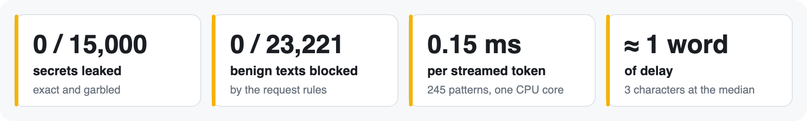

<p align="center">
  
</p>

# mobiusguard-redact

**Streaming redaction for LLM output.** It replaces secrets and personal data in a reply
*while it streams*, including a key split across two chunks, without stopping the stream
and without buffering the whole reply. One dependency (`regex`), pure Python 3.11+, typed.

```sh
pip install mobiusguard-redact
```

```python
from mobiusguard_redact import StreamRedactor

r = StreamRedactor()  # 24 curated patterns + all gitleaks rules
for chunk in llm_stream:  # e.g. "my key is AKIA", "QWERTYUIOPASDFGH ok"
    send(r.feed(chunk))  # emits text as soon as it is safe to
send(r.flush())  # -> "my key is [REDACTED:aws_access_key_id] ok"
r.findings  # pattern IDs and positions, never the secrets
```

Also: `redact(text)` for a whole string, and `redact_stream(iterable)` and
`aredact_stream(async_iterable)` to wrap a stream.

## Why use it

Most guardrails either block a whole reply or don't look inside streams at all. This one
rewrites in place:

- **The same output however the text is split.** For every shipped pattern, property tests
  split each test input at every point and check that the output matches redacting it in
  one go. A fuzz target (Atheris) checks the same property in CI.
- **About one word of delay.** Text is held back only where a secret might be starting:
  3 characters at the median, 36 at P99 and about 170 at most, on real prose and code.
- **It tolerates how models echo secrets:** a few characters added or dropped, keys in
  backticks or quotes, connection strings with an empty user.
- **Fast:** about 0.15 ms per streamed chunk (P50) and 0.4 ms (P99) on one CPU core, with
  all 245 patterns. A keyword prefilter skips rules whose keyword hasn't appeared.
- **Bounded:** at most 8,192 characters are held back. Past that, the held text is redacted
  rather than leaked.

<p align="center">
  
</p>

**Measured:** 0 of 15,000 secrets leaked, exact or garbled, streamed through real messages
in random chunks ([results, 2026-11-02](https://github.com/gantrly/mobius-guard/blob/main/docs/results/2026-11-02-redactor.md)).

## What it finds

| | |
|---|---|
| **Secrets** (curated) | AWS, GitHub, GitLab, OpenAI, Anthropic, Google, Hugging Face, Slack, Stripe and npm keys and tokens; Slack webhook URLs; JSON Web Tokens; private keys; passwords in connection strings; bearer tokens |
| **Personal data** (curated) | emails; payment cards (Luhn); IBAN (mod-97); US SSN; Aadhaar (Verhoeff); PAN; international phone numbers |
| **gitleaks** | all 221 rules of [gitleaks](https://github.com/gitleaks/gitleaks) v8.30.1, with their entropy, allowlist and keyword checks |

That is 24 curated patterns and 221 gitleaks rules. Turn any of them off by ID, or bring your
own:

```python
from mobiusguard_redact import StreamRedactor, default_patterns

r = StreamRedactor(default_patterns(exclude={"generic-api-key"}), label="<{id}>")
```

## Part of Mobius Guard

This package is the redaction layer of [Mobius Guard](https://github.com/gantrly/mobius-guard),
an open-source firewall proxy for LLM apps (`pip install mobiusguard`), which also checks
prompts with its own CPU classifier,
[Fortress-XS](https://huggingface.co/gantrly/fortress-xs). This package is published on
its own so any gateway can embed it.

- [Guide, pattern list and limits](https://github.com/gantrly/mobius-guard/blob/main/docs/redaction.md)
- [How streaming redaction works (decision 0007)](https://github.com/gantrly/mobius-guard/blob/main/docs/decisions/0007-streaming-redaction-semantics.md)
- [Changelog](https://github.com/gantrly/mobius-guard/blob/main/CHANGELOG.md) ·
  [Security policy](https://github.com/gantrly/mobius-guard/blob/main/SECURITY.md)

Alpha: the API may still change before 1.0. Apache-2.0. Every release is built by CI and
published with PyPI trusted publishing; each file carries a build-provenance attestation.
